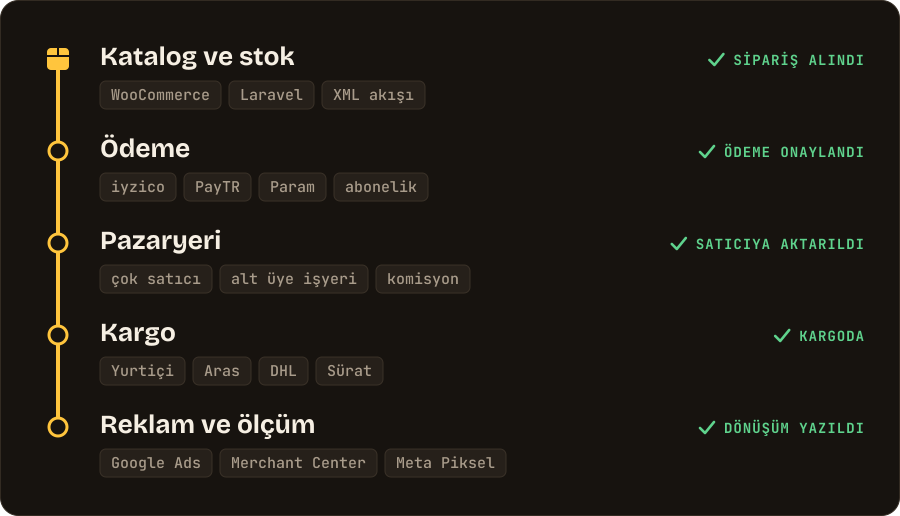
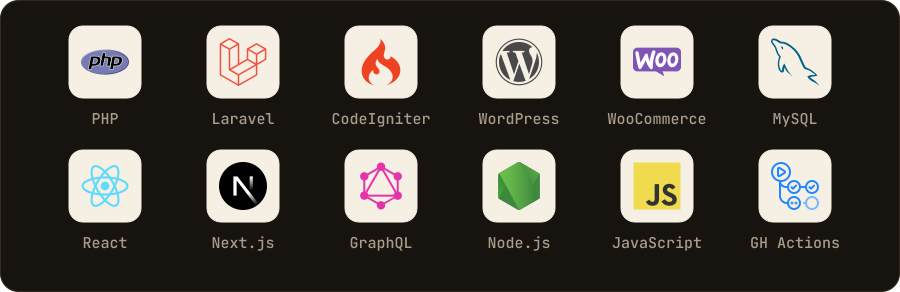

<picture>
  <source media="(prefers-color-scheme: dark)" srcset="https://raw.githubusercontent.com/okantastan/okantastan/master/assets/header-dark.svg">
  <source media="(prefers-color-scheme: light)" srcset="https://raw.githubusercontent.com/okantastan/okantastan/master/assets/header-light.svg">
  
</picture>

  

 

Merhaba, ben Okan. Bodrum'da yaşayan bir full stack geliştiriciyim. 2022'den beri profesyonel olarak yazılım geliştiriyorum, öncesinde freelance e-ticaret projeleri yaptım.

İşimin merkezinde e-ticaret var. Bir ürünün kataloğa girmesinden kargoya verilmesine kadar geçen her adımın yazılım tarafıyla uğraşıyorum: ödeme altyapıları, kargo entegrasyonları, çok satıcılı pazaryerleri ve WooCommerce mağazaları.

## Bir siparişin yolculuğu

<picture>
  <source media="(prefers-color-scheme: dark)" srcset="https://raw.githubusercontent.com/okantastan/okantastan/master/assets/flow-dark.svg">
  <source media="(prefers-color-scheme: light)" srcset="https://raw.githubusercontent.com/okantastan/okantastan/master/assets/flow-light.svg">
  
</picture>

## E-ticarette neler biliyorum

| Alan | Deneyim |
| --- | --- |
| **Sanal POS** | iyzico, PayTR ve Param entegrasyonları, iyzico abonelik API'si, TL/USD kur dönüşümü |
| **Pazaryeri (C2C)** | Çok satıcılı yapı, satıcı panelleri, komisyon, iyzico ve PayTR alt üye işyeri akışları |
| **Ürün tipleri** | Fiziksel ürün, dijital ürün, ilan ve fiyat teklifi modülleri |
| **Kargo** | Yurtiçi, Aras, DHL ve Sürat Kargo entegrasyonları |
| **WooCommerce** | Mağaza kurulumu, Dokan, çoklu para birimi, çoklu dil, ürün varyasyonları |
| **Ürün akışı** | XML ve pazaryeri entegrasyonları, Google Merchant Center |
| **Ölçüm** | Google Ads dönüşüm takibi, çerez onayına bağlı etiketler, Meta Piksel |
| **Mimari** | Laravel ile çok kiracılı yapı: tek kod tabanı, müşteri başına ayrı veritabanı, Next.js ve WPGraphQL ile headless WordPress |
| **Bakım** | WordPress hız ve güvenlik, hosting taşıma, PHP ve Laravel sürüm yükseltme |
| **Yayın** | GitHub Actions ile otomatik deploy, cPanel ve DirectAdmin sunucuları, n8n otomasyonları |

## Kullandığım teknolojiler

<picture>
  <source media="(prefers-color-scheme: dark)" srcset="https://raw.githubusercontent.com/okantastan/okantastan/master/assets/stack-dark.svg">
  <source media="(prefers-color-scheme: light)" srcset="https://raw.githubusercontent.com/okantastan/okantastan/master/assets/stack-light.svg">
  
</picture>

## Örnek işler

- **[3dstock.org](https://3dstock.org):** 3D model pazaryeri. CodeIgniter 4 üzerine iyzico ile abonelik ve ödeme altyapısı.
- **[iyzico-codeigniter](https://github.com/okantastan/iyzico-codeigniter):** CodeIgniter için açık kaynak iyzico entegrasyonu.
- **[YouTube kanalım](https://www.youtube.com/@okantastann):** WooCommerce, Dokan ve iyzico üzerine Türkçe, uygulamalı videolar.

## İletişim

Freelance e-ticaret işleri için [okantastan.com](https://okantastan.com) ya da [LinkedIn](https://www.linkedin.com/in/okantastan) üzerinden yazabilirsiniz.

<b>English</b>

 

I'm Okan, a full stack developer based in Bodrum, Türkiye. I have been working as a software developer since 2022, and I did freelance e-commerce projects before that.

My work is focused on e-commerce software: virtual POS integrations (iyzico, PayTR, Param), shipping integrations (Yurtiçi, Aras, DHL, Sürat), multi-vendor marketplaces with sub-merchant payments and commissions, and WooCommerce stores. I build with PHP, Laravel, CodeIgniter, WordPress, React and Next.js, and I deploy with GitHub Actions.

